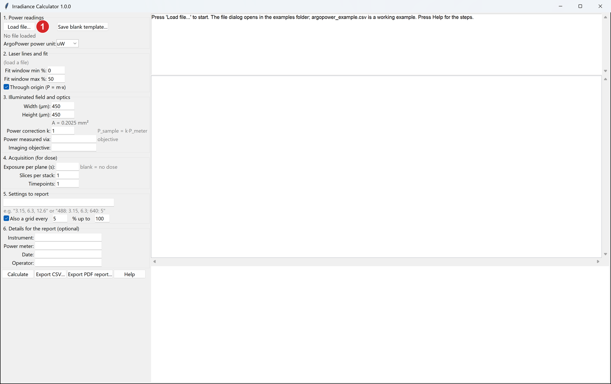
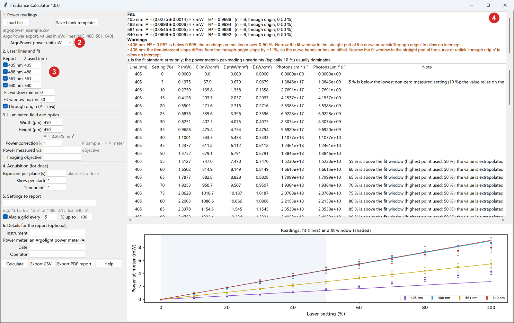
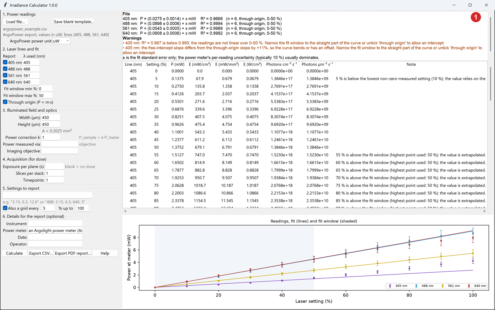
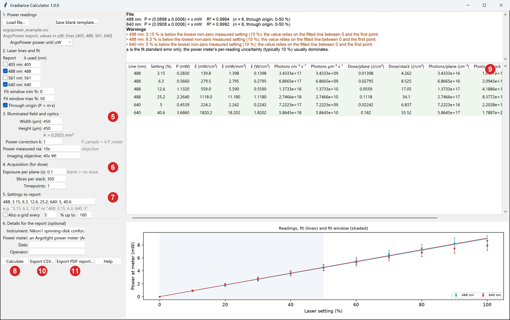
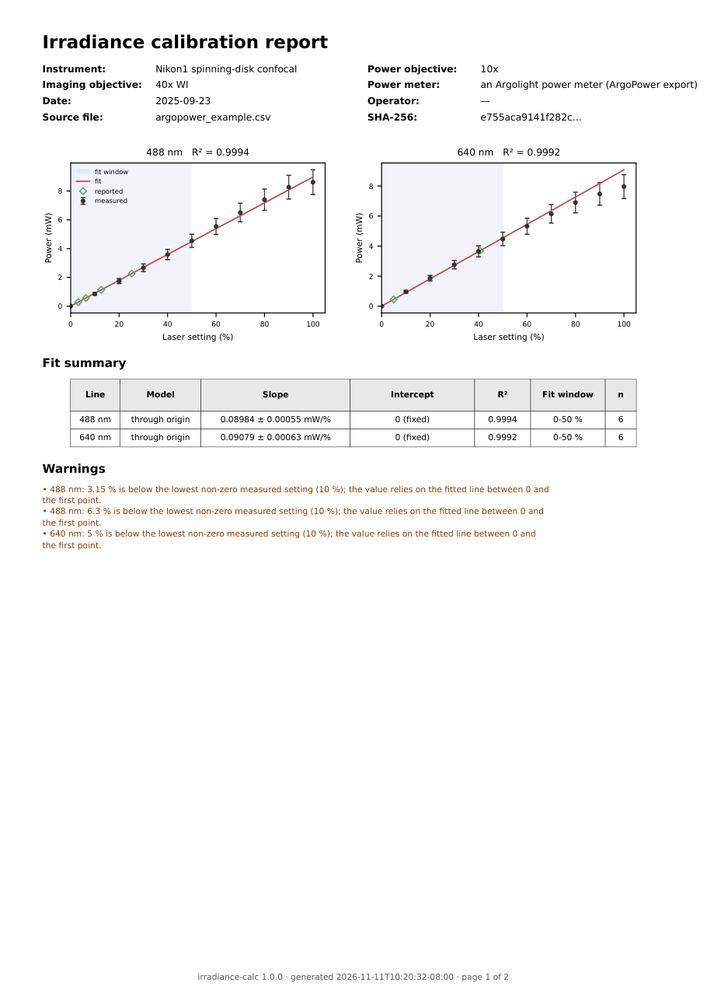
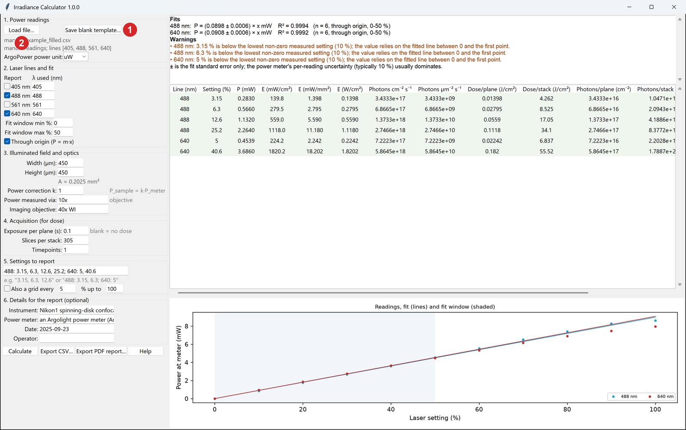

# Irradiance Calculator

**Turn a laser setting (%) into the light that actually reaches your sample.**

"488 nm at 10 %" does not tell a reader how much light hit the cells: the same setting gives different
power on different microscopes, through different objectives, and on the same microscope from one month
to the next. This tool takes your power-meter readings and reports three numbers you can put in a paper
and compare between labs:

| Quantity | Unit | What it means |
| --- | --- | --- |
| **Irradiance** *E* | mW/cm² | Power per area at the sample plane |
| **Photon flux** Φ | photons cm⁻² s⁻¹ | The same, counted in photons (depends on wavelength) |
| **Dose** *H* | J/cm² and photons/cm² | Light delivered per plane, per z-stack and in total |

It also writes a **PDF report** (plots, fits, results and a ready-to-edit methods paragraph) and a **CSV
file with all the data**, so every number can be traced back to the meter readings.

It was written for the QUAREP-LiMi guidelines paper *"Irradiance measurement guidelines to enhance rigor
and reproducibility in light microscopy"*; see [How to cite](#how-to-cite).

---

## Contents

1. [Download and install](#1-download-and-install)
2. [Example 1: an ArgoPower file](#2-example-1-an-argopower-file)
3. [Example 2: measuring by hand with a Thorlabs (or any) power meter](#3-example-2-measuring-by-hand)
4. [How to measure your illuminated area](#4-how-to-measure-your-illuminated-area)
5. [Reading your results](#5-reading-your-results)
6. [Common problems](#6-common-problems)
7. [Definitions and formulas](#7-definitions-and-formulas)
8. [How to cite, licence](#how-to-cite)
9. [For developers](#for-developers)

---

## 1. Download and install

Go to the **[latest release](https://github.com/derekthirstrup/microscope-irradiance/releases/latest)**
and download the file for your computer:

| Computer | File | What to do |
| --- | --- | --- |
| Windows 10/11 | `IrradianceCalculator-…-windows-setup.exe` | Double-click and follow the installer. No administrator rights needed. |
| Windows, no install | `IrradianceCalculator-…-windows-portable.zip` | Unzip anywhere and double-click `IrradianceCalculator.exe`. |
| Mac (Apple silicon, M1 and later) | `IrradianceCalculator-…-macos-arm64.zip` | Unzip and drag `IrradianceCalculator.app` to Applications. |
| Mac (Intel) | `IrradianceCalculator-…-macos-x86_64.zip` | As above. |
| Linux | `IrradianceCalculator-…-linux-x86_64.tar.gz` | Unpack and run `IrradianceCalculator/IrradianceCalculator`. |

You do not need Python.

**The first time you open it**, your computer may warn you. The app is free and open source but not
"code-signed" (signing costs money and is tied to a company), so the operating system does not recognise
the publisher.

- **Windows** shows a blue box, *"Windows protected your PC"*. Click **More info**, then **Run anyway**.
  Some antivirus programs also flag new programs built with PyInstaller; this is a known false positive.
  If your institute blocks unsigned programs, ask IT to allow it, or use the [Python
  install](#for-developers).
- **macOS** says the app *"cannot be opened because the developer cannot be verified"*. Click **Done**
  (not *Move to Bin*). Then, in Finder, **right-click** (or Control-click) the app and choose **Open**,
  and click **Open** again in the box that appears. On macOS 15 and later: open **System Settings →
  Privacy & Security**, scroll down to the message about IrradianceCalculator and click **Open Anyway**.

You only need to do this once.

Each download is listed with its SHA-256 checksum in `SHA256SUMS.txt` on the release page, if you want to
check the file is intact.

---

## 2. Example 1: an ArgoPower file

This example uses the ArgoPower export that the paper's numbers come from. The file ships with the app:
the **Load file…** dialog opens in the examples folder.

**Step 1.** Open the app and click **Load file…** ①. Choose `argopower_example.csv`.



**Step 2.** Check what was read.

- ② **ArgoPower power unit.** ArgoPower normally exports microwatts (**uW**). If your export is in mW,
  change it here; getting this wrong scales every result by 1000.
- ③ **Laser lines.** Tick the lines you want to report. The **λ used** box is the wavelength used for photon
  numbers; change it if your "640" laser is really 638 nm.
- ④ **Fits and warnings.** One line per laser: the fitted slope (mW per %) and R². Look at the plot at
  the bottom: inside the shaded fit window the points must lie on the line.



Here the app warns that **405 nm is not linear** over 0-50 %. You can see why on the plot: the purple
points curve upwards. For a line like this, narrow the fit window (for example 0-30 %) or untick
**Through origin**, and only report settings inside the window.



**Step 3.** Fill in the rest (numbers refer to the picture below):

- ⑤ **Illuminated field.** Width and height of the illuminated area at the sample, in µm
  (here 450 × 450 µm = 0.2025 mm²). See [section 4](#4-how-to-measure-your-illuminated-area). Also say
  which objective the power was measured through and which you imaged with; both go into the report.
- ⑥ **Acquisition.** Exposure time per plane (s), slices per z-stack and number of timepoints. Leave the
  exposure blank if you only want irradiance.
- ⑦ **Settings to report.** The laser settings you imaged at, separated by commas. Use `488: 3.15, 6.3;
  640: 5` to give different settings per line. Untick *Also a grid* if you only want these rows.
- ⑧ Click **Calculate**.



**Step 4.** Read the results ⑨: one row per laser line and setting. For this example, with
`488: 3.15, 6.3, 12.6, 25.2; 640: 5, 40.6`, exposure 0.1 s and 305 slices, you should see exactly:

| Line | Setting | P (mW) | E (mW/cm²) | Photons cm⁻² s⁻¹ | Dose/stack (J/cm²) |
| --- | --- | --- | --- | --- | --- |
| 488 | 3.15 | 0.2830 | 139.8 | 3.4333e+17 | 4.262 |
| 488 | 6.3 | 0.5660 | 279.5 | 6.8665e+17 | 8.525 |
| 488 | 12.6 | 1.1320 | 559.0 | 1.3733e+18 | 17.05 |
| 488 | 25.2 | 2.2640 | 1118.0 | 2.7466e+18 | 34.1 |
| 640 | 5 | 0.4539 | 224.2 | 7.2223e+17 | 6.837 |
| 640 | 40.6 | 3.6860 | 1820.2 | 5.8645e+18 | 55.52 |

If your numbers match, the app is installed correctly.

The app notes that 3.15 %, 6.3 % and 5 % are **below the lowest measured setting** (10 %). The value
then depends on the straight line from 0 to the first reading. That is usually fine for a laser that is
linear, but if those low settings matter, measure them directly.

**Step 5.** Save your results.

- ⑩ **Export CSV…** writes one file with everything: the settings you used, every result column, the fit,
  and the original readings. You can load this file back into the app later.
- ⑪ **Export PDF report…** writes a two-page report. Page 1:



Page 2 holds the inputs, the results table, and a methods paragraph you can paste into a paper.

---

## 3. Example 2: measuring by hand

Use this if you measure with a stand-alone meter, such as a Thorlabs PM100D or PM400 with a slide
(microscope) sensor, and write the readings down.

**Taking the readings**

1. Let the lasers warm up as you would for imaging (typically 30 min).
2. Put the sensor at the sample plane, under the objective you image with, and focus on its surface.
3. With the laser **off**, zero the meter.
4. For each laser line, **set the meter's wavelength to that line first**. The sensor's sensitivity
   depends on wavelength, so a wrong setting gives wrong readings.
5. Step the laser through the settings (0, 10, 20 … 100 %) and note the power at each. Wait for the
   reading to settle.

**Entering them**

1. In the app, click **Save blank template…** ①, type the laser lines you have (for example
   `488, 561, 640`) and save the file.
2. Open the file in Excel. Type your readings in **mW** under each laser line. Fill in instrument,
   objective, power meter, date and operator in the `#` lines at the top if you want them in the report.
   Leave a cell empty if you did not measure it. To add repeat readings, add a row with the same setting.
   Save as **CSV**.
3. Load it with **Load file…** ② and continue as in Example 1, from Step 2.



A filled-in example, `manual_example_filled.csv` in the examples folder, holds the same readings as the
ArgoPower example and gives identical results.

The filled-in example looks like this (readings in µW? name the columns `488_uW` instead of `488_mW`):

```
# instrument: Nikon1 spinning-disk confocal
# objective: 10x
# power_meter: Argolight SLPM-115 (values transcribed from the ArgoPower export)
# date: 2025-09-23
# operator:
setting_pct,405_mW,488_mW,561_mW,640_mW
0,0.000,0.000,0.000,0.000
10,0.160,0.850,0.487,0.957
20,0.430,1.747,1.051,1.864
...
```

---

## 4. How to measure your illuminated area

Irradiance is power divided by the illuminated area, so the area matters as much as the power.

- **Bleached-dye method** (used for the paper): cover a slide with a thin, uniform fluorescent dye layer,
  illuminate it at full power for a few seconds through the imaging objective so that it bleaches, then
  image the bleached patch with a lower-magnification objective and measure its width and height.
- **Camera field of view**: if the illumination overfills the camera, the camera field (pixel size ×
  number of pixels) is a lower bound on the illuminated area and gives an upper bound on irradiance.
- **Fluorescent slide**: image a uniform fluorescent slide and measure the size of the illuminated region.

The app assumes the light is spread evenly over a rectangle of that width and height. Real illumination
is often brighter in the middle; *E* is then the average over the field.

---

## 5. Reading your results

- **Report irradiance in mW/cm²** together with the wavelength, the illuminated area and how you measured
  power. Add photon flux if your readers think in photons (photochemistry, phototoxicity).
- **Dose per stack** is what a cell receives during one z-stack; **total dose** multiplies by the number
  of timepoints.
- The **±** on the slope is only the fit error. The real uncertainty is set by the power meter, typically
  **±10 %** per reading (check your meter's datasheet). Ratios between settings on the same laser are much
  better determined than the absolute value.

A methods sentence to edit (the PDF report writes a longer version with your numbers filled in):

> Laser power at the sample plane was measured with a [power meter] through the [objective] and fitted
> against the laser setting (linear, through the origin, 0-50 %). Irradiance was calculated as *E* =
> *P*/*A* with an illuminated field of [450 × 450 µm]. Images were acquired at [139.8 mW/cm²] (488 nm;
> [3.4 × 10¹⁷] photons cm⁻² s⁻¹), [0.1 s] per plane, [305] planes per stack (dose [4.26 J/cm²] per stack).
> Irradiance values were calculated with Irradiance Calculator [version] [ref].

---

## 6. Common problems

| Problem | What to do |
| --- | --- |
| All numbers are 1000× too big or too small | The **ArgoPower power unit** is wrong. ArgoPower usually exports uW. Manual templates carry the unit in the column name (`_mW`/`_uW`) and are not affected. |
| *"R² is below 0.995"* or *"slopes differ"* | The readings are not a straight line in the fit window; usually the laser rolls off at high power. Narrow the fit window (e.g. 0-30 %) and only report settings inside it. |
| *"below the lowest non-zero measured setting"* | You asked for a setting below your first reading. Measure a few low settings if those are the ones you image at. |
| *"above the fit window"* | The value is extrapolated. Widen the fit window only if the plot shows the points are still on the line. |
| *"This file is not in a recognised format"* | The app reads ArgoPower exports, the manual template, and its own CSV exports. Use **Save blank template…** and copy your numbers into it. If Excel changed the column names, put them back to `setting_pct,488_mW,…`. |
| *"is not a number"* | A cell contains text (e.g. `0.85 mW` or `n/a`). Keep only the number, or leave it empty. |
| The app does not open on Windows / macOS | See [first-time warnings](#1-download-and-install). |

---

## 7. Definitions and formulas

With *P* the fitted power (mW) at the setting, *k* an optional correction factor (default 1), *A* the
illuminated area, λ the wavelength, *t* the exposure per plane, *N* slices per stack and *T* timepoints:

- Irradiance: *E* = *k P* / *A*; in mW/cm², *E* = 100 *k P*[mW] / *A*[mm²]
- Photon flux: Φ = *E* λ / (*h c*) = 5.034117 × 10¹² · *E*[mW/cm²] · λ[nm] photons cm⁻² s⁻¹
- Dose: *H*_plane = *E t*, *H*_stack = *E t N*, *H*_total = *E t N T* (J/cm², and the same with Φ for photons/cm²)

Assumptions: *E* is averaged over the field and over time (not the peak at a spinning-disk pinhole or a
scanned spot); the dose per stack assumes every slice exposure lights the whole axial column (true for
widefield and spinning disk, not light-sheet); *t* is the time the laser is on per plane; photons are
counted as delivered, not absorbed.

Full details, including the fit and the warnings: [docs/methods.md](docs/methods.md). File formats and
the command line: [docs/user-guide.md](docs/user-guide.md).

---

## How to cite

If you use this tool, please cite the software (see [`CITATION.cff`](CITATION.cff); GitHub's *Cite this
repository* button gives the formatted reference) and the QUAREP-LiMi irradiance guidelines paper.

## Licence

BSD 3-Clause, see [LICENSE](LICENSE).

---

## For developers

The core (`parse`, `fit`, `units`, `table`, `cli`) is pure standard-library Python so the calculation is
small and easy to audit. matplotlib is needed only for the plot and the PDF report.

```bash
pip install "irradiance-calc[gui] @ git+https://github.com/derekthirstrup/microscope-irradiance"
irradiance-calc-gui                    # the app
irradiance-calc --help                 # the command line
```

Reproduce the paper's numbers with one command:

```bash
irradiance-calc examples/argopower_example.csv --width-um 450 --height-um 450 --lines 488,640 \
    --settings "488: 3.15, 6.3, 12.6, 25.2; 640: 5, 40.6" --exposure-s 0.1 --slices 305 \
    --power-objective 10x --imaging-objective "40x WI" --csv paper.csv --report paper.pdf --methods
```

Development:

```bash
git clone https://github.com/derekthirstrup/microscope-irradiance && cd microscope-irradiance
python -m pip install -e ".[dev]"
ruff check src tests scripts
pytest                                  # the GUI test is skipped without a display
python scripts/capture_screenshots.py   # Windows: refresh docs/img from the running app
```

Building the installer (what `.github/workflows/release.yml` does on a `v*` tag):

```bash
pip install pyinstaller
pyinstaller packaging/irradiance_calc.spec --noconfirm      # -> dist/IrradianceCalculator/
iscc /DMyAppVersion=1.0.0 packaging\installer.iss           # Windows, needs Inno Setup 6
```

Layout: `src/irradiance_calc/` the package, `tests/`, `examples/` the example files, `docs/` the guide and
methods, `packaging/` PyInstaller and Inno Setup, `scripts/` the screenshot script.
